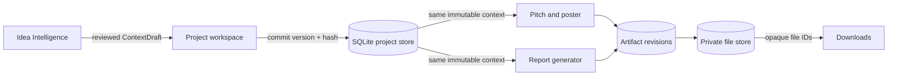

# Integrated module connections

The application runs as one FastAPI service and one React app at `http://127.0.0.1:8000`. Member 1 owns idea extraction, web research, reviewed analysis, debate and source figures. Member 2 owns pitch deck and poster generation. Member 3 owns report generation and shared project, job, artifact and file services.

All modules read the same immutable `ProjectContext`. The caller must pass the complete saved context, not only its ID. The host validates the context hash and compares the supplied object with the exact stored version before accepting generation. Research review status never blocks debates, context saving, or output generation. Missing evidence and unresolved findings remain visible as gaps; unsupported facts stay labelled as assumptions or unknowns.

## Runtime flow

1. Create or reopen a project. Submit its idea to Member 1 for extraction, research and reviewed analysis.
2. Commit the reviewed draft as an immutable context version. Corrections create another version rather than changing the saved snapshot.
3. Pass the same saved context version to any combination of the pitch, poster and report endpoints. They use one API host and run as independent jobs; a combined run endpoint starts the three requested generators concurrently.
4. Each generator saves editable structured content as revision 1 and registers one or more rendered files. The manifest records the exact project, context version and content revision.
5. The workspace previews and edits structured content. An edit uses optimistic revision checking and creates a new immutable revision. Rendering names the selected revision and does not remove earlier downloads.

## API endpoints

All paths use the `/api/v1` prefix. All generation and render POSTs require `Idempotency-Key` and return a `JobReceipt`. Poll the returned `status_url` until the job reaches `succeeded`, `partial_success` or `failed`.

| Method | Path | Purpose |
| --- | --- | --- |
| GET | `/health` | Reports live module capabilities and provider configuration. |
| POST | `/projects` | Creates project metadata and initial idea text. |
| GET | `/projects` | Lists saved projects. |
| GET | `/projects/{project_id}` | Reads project metadata and current context version. |
| PATCH | `/projects/{project_id}` | Updates metadata with `expected_revision`; context history remains unchanged. |
| POST | `/projects/{project_id}/contexts` | Atomically commits a reviewed `ContextDraft` with `expected_latest_version`. |
| GET | `/projects/{project_id}/contexts` | Lists immutable context version summaries. |
| GET | `/projects/{project_id}/context` | Reads the latest committed context. |
| GET | `/projects/{project_id}/contexts/{version}` | Reads an exact immutable context snapshot. |
| GET | `/projects/{project_id}/contexts/{version}/handoff` | Returns that snapshot, its hash and output module availability. |
| POST | `/projects/{project_id}/runs` | Extracts and reviews an idea, commits one version, then starts requested outputs concurrently. |
| POST | `/intelligence/extractions` | Member 1: structures an idea in an async job. |
| GET | `/intelligence/models` | Lists allowed model choices, the configured default and installed availability. |
| POST | `/intelligence/analyses` | Member 1: researches, retrieves, critiques and revises an idea in an async job. |
| GET | `/intelligence/analyses/{analysis_id}` | Reads an analysis draft, evidence, figures and review result. |
| POST | `/intelligence/debates` | Member 1: starts a user-versus-agent or agent-versus-agent debate. |
| GET | `/intelligence/debates/{debate_id}` | Reads the debate transcript and moderator summary. |
| POST | `/intelligence/debates/{debate_id}/resume` | Resumes a failed debate at its first missing validated turn, preserving the transcript and round count. Requires `Idempotency-Key`. |
| POST | `/intelligence/debates/{debate_id}/turns` | Adds a user turn to an interactive debate. |
| GET | `/integration/modules` | Reports installed output modules and their public routes. |
| GET | `/studio/templates?kind=pitch_deck` | Member 2: lists pitch deck templates, formats and option bounds. |
| POST | `/studio/pitch-decks` | Member 2: produces editable slide content and a PPTX. |
| GET | `/studio/templates?kind=poster` | Member 2: lists poster templates, formats and option bounds. |
| POST | `/studio/posters` | Member 2: produces editable poster content and a TXT export. |
| GET | `/reports/templates` | Member 3: lists report templates and DOCX/PDF support. |
| POST | `/reports/generations` | Member 3: produces editable formal report content and requested exports. |
| GET | `/jobs/{job_id}` | Reads progress, result, context pin and structured error. |
| GET | `/projects/{project_id}/jobs` | Lists the latest 100 matching jobs. Optional `operation` filter, plus `debate_id` for `debate_turn`, keeps long debate restoration independent of other job history. |
| GET | `/projects/{project_id}/artifacts` | Lists output manifests, optionally filtered by context version or kind. |
| GET | `/artifacts/{artifact_id}` | Reads artifact metadata and available files. |
| GET | `/artifacts/{artifact_id}/content?revision={n}` | Reads a selected immutable content revision. |
| PUT | `/artifacts/{artifact_id}/content` | Saves edited content with `base_revision`, creating a new revision. |
| POST | `/artifacts/{artifact_id}/renders` | Renders the selected `content_revision` into requested formats as an async job. |
| GET | `/files/{file_id}/download` | Streams a registered file by opaque ID. |

Requests and schemas for all generation methods live in `schemas/` and in `member1/backend/app/integration/contracts.py`. The synthetic sample context is `fixtures/project_context.demo.json`; it is for development and must not be presented as real market research.

## Output options

`GET /studio/templates?kind=pitch_deck` currently returns `investor-brief`, supporting PPTX, 5–12 slides, and professional, bold or academic tone. `GET /studio/templates?kind=poster` returns `evidence-one-pager`, supporting TXT. `GET /reports/templates` returns `evidence-led-report`, supporting DOCX and PDF. Always select IDs from these endpoints.

Deck content contains a title and slides with body blocks, speaker notes and source/evidence references. Poster content contains a title and evidence-linked sections. Report content contains a title, sections, paragraphs and a bibliography built from the context sources. Unsupported numbers remain labelled assumptions or gaps. Figure cards preserve the source's literal value, excerpt and qualification.

## Versioning, jobs and files

Context versions and artifact content revisions are separate. Every artifact stores `context_version` and `context_hash`; every file stores `content_revision`. Editing wording does not change project facts or context hashes. To correct facts, rerun analysis and commit a new context. To update an export, edit the artifact content, save the new revision and render it.

The same idempotency key and payload return the original job. Reusing that key with different input returns `409 IDEMPOTENCY_CONFLICT`. Stale project revisions, context versions or artifact content revisions return 409 and preserve stored data. A combined run can return `partial_success`, with successful and failed output jobs listed separately. Each job pins the context version used to produce its result.

File bytes live in Member 3's local data directory. API responses expose only file IDs, names, formats, sizes and download URLs. Downloads never accept filesystem paths. Local single-process SQLite and in-process jobs are suitable for this capstone workspace; multi-user production deployment would require authentication, authorization and a durable worker queue.
